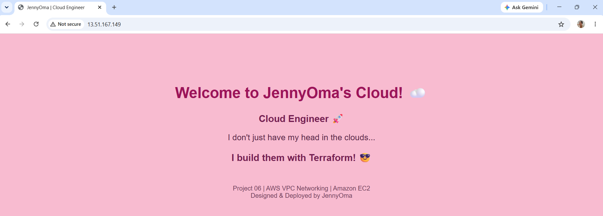

# AWS VPC Networking with Terraform

A hands-on AWS networking project demonstrating how to provision and manage a secure Virtual Private Cloud (VPC) using Terraform.

## Architecture

The project uses the AWS Stockholm region (`eu-north-1`) and includes:

- Custom VPC (`10.0.0.0/16`)
- Public subnet (`10.0.1.0/24`)
- Private subnet (`10.0.2.0/24`)
- Internet Gateway
- NAT Gateway and Elastic IP
- Public EC2 web server
- Private EC2 instance
- Public and private route tables
- Security groups
- AWS Systems Manager for EC2 management

## Network Design

| Component | Purpose |
|---|---|
| Public subnet | Hosts the public web server and NAT Gateway |
| Private subnet | Hosts an EC2 instance without a public IP |
| Internet Gateway | Provides internet connectivity for public resources |
| NAT Gateway | Provides outbound IPv4 internet access for private resources |
| Security groups | Control permitted network traffic |
| Route tables | Determine network traffic paths |

## Security Features

- Private EC2 instance has no public IPv4 address.
- No inbound SSH access is configured.
- AWS Systems Manager is used for administrative access.
- EC2 instances require IMDSv2.
- EBS root volumes are encrypted.
- IAM roles provide EC2 access to Systems Manager.

## Terraform Commands

Initialise Terraform:

```bash
terraform -chdir=terraform init
```

Validate the configuration:

```bash
terraform -chdir=terraform fmt -check
terraform -chdir=terraform validate
```

Preview the deployment:

```bash
terraform -chdir=terraform plan
```

Deploy after reviewing the plan and costs:

```bash
terraform -chdir=terraform apply
```

Remove lab resources after testing:

```bash
terraform -chdir=terraform destroy
```

## Testing Status

**Successfully deployed, tested and decommissioned — October 2026.**

- Deployed 17 AWS resources using Terraform in eu-north-1.
- Verified the public EC2 website through the Internet Gateway.
- Connected to both EC2 instances using AWS Systems Manager.
- Confirmed private EC2 outbound internet access through the NAT Gateway (HTTP 200).
- Created a personalised pink Cloud Engineer website.
- Destroyed all 17 resources and verified the Terraform state was empty.

### My AWS Cloud Engineer Website 💗



The live website has been taken offline to minimise AWS charges.

## Cost Considerations

NAT Gateway, EC2 instances, EBS volumes and public IPv4 addresses may incur charges. This project is intended as a short-lived demonstration environment rather than permanent hosting.

## Author

**JennyOma**

GitHub: https://github.com/JennyOma
